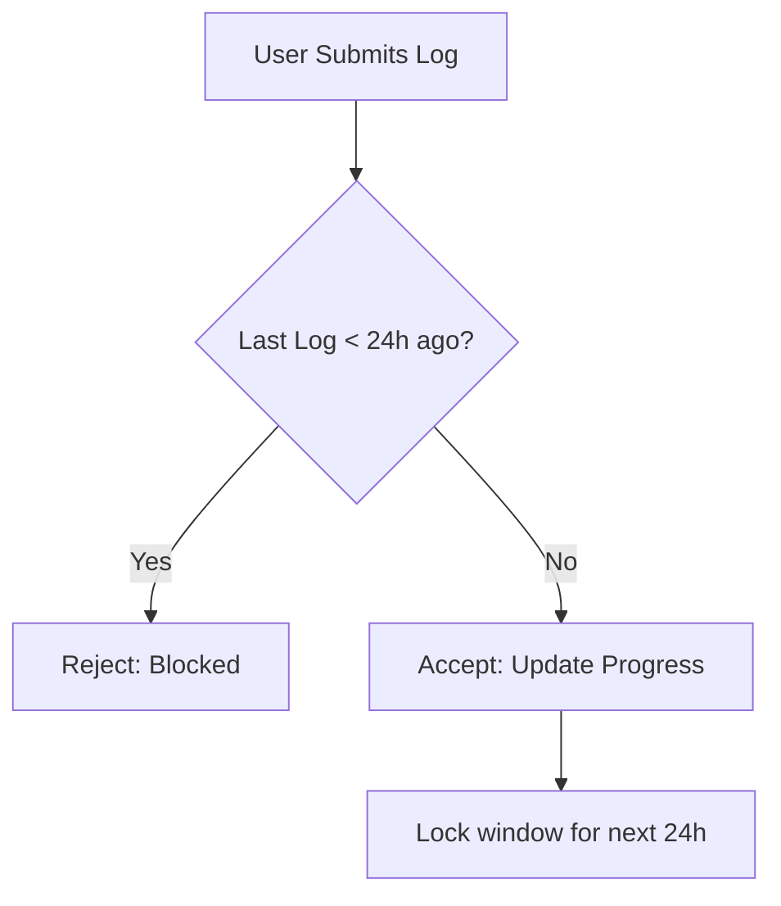

# ExecTrack: Business Logic & Workflow

This document explains the core logic that powers ExecTrack. It is designed to be easy to understand for anyone wanting to learn how the system "thinks."

---

## 1. The Core Loop: The 24-Hour Gatekeeper
ExecTrack is built on a strict 24-hour cycle. You cannot log progress twice in the same day. This prevents "productivity cramming" and enforces genuine consistency.

### How it works (The Logic):
1.  **Request:** User submits a progress update.
2.  **Check:** System looks at the `createdAt` timestamp of the last log for that project.
3.  **Validate:** 
    *   If **Time Elapsed < 24 Hours**: System rejects the update. "You've already done your work for today."
    *   If **Time Elapsed > 24 Hours**: System accepts the update.
4.  **Result:** The user is locked out until the next 24-hour window opens.

---

## 2. The Progress Algorithm
Unlike a standard "checklist" where 10 tasks = 100%, ExecTrack values **Daily Execution**.

### Scoring Logic:
- **"I finished it today" (Completed):** Gives the project a **+10%** boost.
- **"I'm working on it" (Working):** Gives a **+4%** boost.
- **"Didn't work on it" (Not Done):** Gives **0%** boost.

**The Philosophy:** You move faster when you finish things, but you still move forward just by showing up.

---

## 3. Data Visibility (Private vs. Public)
ExecTrack allows you to share your progress without exposing your private data.

### Logic Flow:
- **Private View (Dashboard):** Shows everything—notes, full task list, internal IDs, and edit buttons.
- **Public View (Share Link):** 
    1.  Checks if `isPublic === true`.
    2.  If true, it generates a "Snapshot" of the project.
    3.  It hides your email, your private notes, and your ability to delete things.
    4.  It only shows the **Proof of Work** (the streak, the progress ring, and the log history).

---

## 4. The "Fast but Fresh" Caching Loop
To make the app feel "instant," we use a background caching system.

### The Logic:
1.  **The Box:** When you view your dashboard, we put the data in a "Fast Box" (Cache).
2.  **The Trigger:** When you add a new project or log progress, the system **smashes the box** (Invalidates the cache).
3.  **The Refresh:** The next time you look at the dashboard, the system builds a new "Fast Box" with the latest data.
4.  **The Result:** You get the speed of a cached site with the accuracy of a live database.

---

## 5. Summary
ExecTrack's logic is designed to be **unforgiving but fair**. It rewards the habit of daily work rather than the intensity of a single day's effort.
